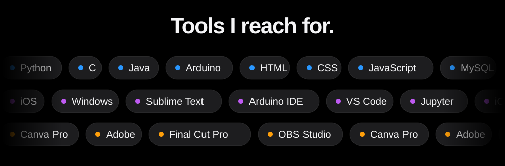

  

 

  

 

## About me

- 🔭 Currently exploring and learning about Artificial Intelligence.
- 🤔 Exploring new technologies and developing software solutions and quick hacks.
- 🎓 In 3rd year of MBA Tech in Artificial Intelligence at MPSTME, NMIMS.
- 💼 Student, open to freelance and hybrid job opportunities.
- 🌱 Enthusiast in Cyber Security and Artificial Intelligence.
- ✍️ Watching movies and trying out new and upcoming technological advances.
- ☕ I believe a perfect cup of coffee can be the ultimate solution for any stress.

 

  

## Tech stack

- 💻 **Languages:** Python, C, Java, Arduino
- 🌐 **Web and platforms:** iOS, Windows, HTML, CSS, JavaScript
- 🛢 **Data and hosting:** MySQL, MongoDB, Railway
- 🔧 **Editors and tools:** Sublime Text, Arduino IDE, Visual Studio Code, Jupyter
- 🖥 **Creative:** Canva Pro, Adobe, Final Cut Pro, OBS Studio
